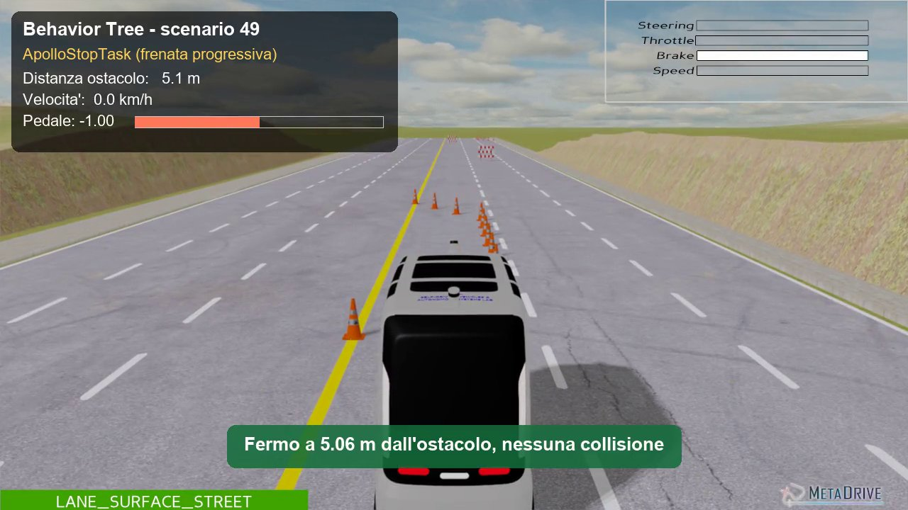

# iseauto_bt: Milestone v1

🇮🇹 [Versione italiana](README.md)

ROS 2 Humble package for the iseAuto shuttle: a C++ Behavior Tree (BehaviorTree.CPP v3) for longitudinal control, a passive bridge to the MetaDrive simulator, and a PPO agent used as a baseline for comparison.

This is the code of the bachelor's thesis *"Modellazione e analisi di alberi di comportamento per la guida autonoma"* (Universitas Mercatorum). The thesis is written in Italian; this README is enough to build, run and reproduce the results.

> **Provenance.** The original code was lost. `bt_trees/iseauto_tree.xml` is the recovered original. `src/brain_node.cpp.recuperato` is the recovered original skeleton. Everything else was **rebuilt from the thesis**. The results reported in the submitted thesis (Chapter 5) are the ones produced by the code at tag [`tesi`](https://github.com/alesca18/iseauto-behavior-tree/tree/tesi); later fixes are described in [Differences from the thesis](#differences-from-the-thesis).

## Video

[](media/milestone_v1.mp4)

Scenarios 49 and 14: obstacle in the lane, progressive braking and stop at about 5 m. Scenario 4: cones in the adjacent lane, the shuttle keeps going. Overlay: active tree node, distance, speed and pedal. Cruise-only stretches are sped up x3. To regenerate it: `python tools/record_video.py` (needs `pip install imageio imageio-ffmpeg`).

## Layout

| File | Role |
|---|---|
| `bt_trees/iseauto_tree.xml` | BTCPP v3 tree (Listing 4.1 of the thesis) |
| `src/brain_node.cpp` | C++ node: subscribes to `/closest_obstacle`, ticks at 30 Hz, publishes `/cmd_vel` |
| `scripts/metadrive_bridge.py` | Passive bridge: telemetry and actuation, statistics over the 50 test scenarios |
| `scripts/scenario.py` | Shared MetaDrive setup (straight road, obstacles, spawn at 0 km/h, fixed shuttle parameters) and the `IseAutoVehicle` class |
| `assets/iseauto/` | 3D model of the iseAuto shuttle (body and wheels, glTF) |
| `scripts/train_ppo.py` / `eval_ppo.py` | Training and evaluation of the PPO agent |
| `scripts/kill_ghosts.sh` | Cleans up leftover ("ghost") ROS processes (Sec. 3.3) |
| `launch/iseauto_v1.launch.py` | Starts bridge and brain together |
| `test/sim_senza_ros.py` | ROS-free test bench (see below) |
| `test/ros_integration_test.sh` | Real ROS 2 integration test |

`/cmd_vel` convention: `linear.x` = pedal in [-1, 1] (positive throttle, negative brake), `angular.z` = steering in [-1, 1]. The MetaDrive action is `[angular.z, linear.x]`.

## Installation (Ubuntu 22.04 / WSL2)

```bash
sudo apt install ros-humble-desktop ros-humble-behaviortree-cpp-v3
pip install -r requirements.txt

mkdir -p ~/ros2_ws/src && cp -r iseauto_bt ~/ros2_ws/src/
cd ~/ros2_ws && source /opt/ros/humble/setup.bash
colcon build --packages-select iseauto_bt && source install/setup.bash
chmod +x src/iseauto_bt/scripts/*.py src/iseauto_bt/scripts/*.sh
```

## Running

```bash
ros2 run iseauto_bt kill_ghosts.sh                       # before each session
ros2 launch iseauto_bt iseauto_v1.launch.py episodes:=50
```

Or in two terminals: `ros2 run iseauto_bt metadrive_bridge.py --episodes 50` and `ros2 run iseauto_bt brain_node`.
At the end the bridge prints the collision rate and the stopping distance (mean/min/max). The brain prints the worst-case tick time (WCET) every 5 s.

## Watching the simulation

The MetaDrive 3D window opens automatically with the bridge. Use `--headless` to run without graphics (as in CI).

| What | Command |
|---|---|
| Behavior Tree with ROS 2 (Ubuntu / WSL2) | `ros2 launch iseauto_bt iseauto_v1.launch.py episodes:=5` |
| Behavior Tree without ROS (Windows too) | `python test/sim_senza_ros.py scripts 5 --render` |
| PPO agent | `python3 scripts/eval_ppo.py --model models/ppo_iseauto_600k --episodes 5 --render` |

- **Without ROS:** with `--render` the test runs in real time (30 Hz) so it can be followed. Without the flag it runs as fast as possible with no window.
- **WSL2 on Windows 11:** the window appears through WSLg with no configuration. If it does not open, check that `echo $DISPLAY` is not empty and update WSL with `wsl --update` from PowerShell.
- **Headless server or container:** use `--headless`.
- **Window requirement:** MetaDrive needs `panda3d-gltf` between 0.13 and 1.0. With 1.x the headless test works, but the window fails with `Could not load Actor model ... scene.gltf`. Fix: `pip install "panda3d-gltf>=0.13,<1.0"`.

## PPO agent

```bash
python3 scripts/train_ppo.py --episodes 100      # saves models/ppo_iseauto.zip
python3 scripts/eval_ppo.py --episodes 50        # collisions, mean reward, inference time
```

## ROS-free test bench

`test/sim_senza_ros.py` runs the real `metadrive_bridge.py`, with ROS replaced by stub modules, connected to a line-by-line Python port of `brain_node.cpp`. It uses a simulated clock. It is meant for trying the scenario and the control law where ROS 2 is not available (Windows included).

```bash
python test/sim_senza_ros.py scripts 50
```

## Results

Methodology: 50 fixed scenarios (seeds 0–49), one run per scenario; values are aggregated over the 50 scenarios (rates, means, min–max). The PPO agent is trained on 100 different scenarios (seeds 100–199) and, since the outcome depends on the training seed, every configuration is trained **three times** (`--ppo-seed` 0, 1, 2). Vehicle: `IseAutoVehicle` (3.60 × 1.50 × 2.40 m, 1250 kg). Obtained on 29/10/2026 (Windows, Python 3.14, MetaDrive 0.4.3 from GitHub, SB3 2.9.2):

| | Behavior Tree (calibrated brake) | PPO, 100 episodes (seeds 0 / 1 / 2) | PPO, 600k steps (seeds 0 / 1 / 2) |
|---|---|---|---|
| Collisions over 50 tests | 0/50 | 0 / 0 / 0 (always leaves the road before reaching obstacles) | 1 / 6 / 18 (mean 17%) |
| Outcome | 36 stops, 14 arrivals at destination | 50 off-road in all three | arrivals 49 / 32 / 17, off-road 0 / 12 / 15 |
| Stopping distance | 5.05 m mean (5.03–5.08), std 0.017 m | - | - |
| Mean evaluation reward | - | +24.0 / +29.3 / +20.7 | +441.7 / +352.2 / +313.2 (mean +369.0) |
| Time per decision | 0.34 ms max (Python port) | 0.2–0.3 ms mean, ≤ 1.6 ms max | 0.2–0.3 ms mean, ≤ 3.0 ms max |

The PPO hyperparameters (`n_steps=1024`, `lr=5e-4`) are the best of 5 configurations tried in a preliminary phase with MetaDrive's generic vehicle. Mean reward during the long training run with seed 0, in blocks of 100 episodes:

| Episodes | 100 | 300 | 500 | 600 | 700 | 800 | 1000 |
|---|---|---|---|---|---|---|---|
| Mean reward | +28 | +41 | +91 | +186 | +208 | +227 | +249 |

The seed-0 600k-step model is in `models/ppo_iseauto_600k.zip`. To regenerate the three repetitions:

```bash
for s in 0 1 2; do
  python3 scripts/train_ppo.py --timesteps 600000 --ppo-seed $s --out models/ppo600_s$s
  python3 scripts/eval_ppo.py --model models/ppo600_s$s       # collisions, arrivals, off-road
done
```

For reference, MetaDrive's built-in expert driver (IDM) gets 49 arrivals, 0 collisions and a mean reward of +440.7 on the same 50 scenarios.

### Differences from the thesis

Two things were fixed in the bridge after submission. The exact thesis code is still available at tag `tesi` (`git checkout tesi`).

1. **Fixed-seed scenarios.** The bridge called `env.reset()` without a seed, and in that case MetaDrive draws a random scenario from the range at every reset. The 50 Behavior Tree tests reported in the thesis are therefore 50 random draws among seeds 0–49, not each seed once (some repeated, some missing), and the counts of stops and arrivals changed from run to run. Now test *i* uses seed `seed + i` and two runs give the same result. The PPO evaluations already passed the seed explicitly and do not change.
2. **Sensor corridor.** The corridor was as wide as the lane (±1.75 m): in some scenarios the shuttle stopped for cones closing the adjacent lane, which it would have passed with about 0.9 m of clearance. Now the corridor is as wide as the shuttle plus 0.5 m per side (±1.25 m).

| Behavior Tree, 50 scenarios | Thesis (tag `tesi`) | Current code |
|---|---|---|
| Collisions | 0/50 | 0/50 |
| Outcome | 33 stops, 17 arrivals (random draws) | 36 stops, 14 arrivals (seeds 0–49) |
| Stopping distance | 5.05 m (5.03–5.08), std 0.018 m | 5.05 m (5.03–5.08), std 0.017 m |

The thesis conclusions do not change: no collisions and a stop at 5 m within a few centimetres.

## Continuous integration (GitHub Actions)

`.github/workflows/ci.yml` runs on every push in a `ros:humble` container (Ubuntu 22.04):

1. `colcon build` of the package, including the C++ `brain_node`;
2. ROS-free test (`test/sim_senza_ros.py`, 20 scenarios);
3. real ROS 2 integration test (`test/ros_integration_test.sh`, 10 scenarios): `brain_node` and `metadrive_bridge.py` talk over topics. It fails on any collision or if a stop falls outside 4.8–5.2 m;
4. quick PPO training and evaluation run.

Results of the real ROS 2 integration test in CI (three runs of the first 10 scenarios, compiled C++ `brain_node`): 0 collisions; all three have the same 6 stops (scenarios 0, 2, 3, 5, 8, 9) between 4.89 and 5.05 m and 4 arrivals; tick WCET at most 0.29 ms. (In the thesis, with randomly drawn scenarios: 6 / 6 / 8 stops between 4.89 and 5.08 m.) In stops below 5 m, `ApolloEmergencyStop` kicks in (pedal −1.0).

The integration test can also be run by hand, after `colcon build` and `source install/setup.bash`:

```bash
bash test/ros_integration_test.sh 10
```

### Brake calibration

MetaDrive randomizes the vehicle's brake force at every episode (about 90–170). At those values the shuttle already decelerates by about 2.6 m/s² at −0.1 pedal, so with the thesis' quadratic ramp it stopped about 19.3 m from the obstacle (19.6 m predicted by the equation in Chapter 4).

`IseAutoEnv` now fixes the shuttle parameters (`SHUTTLE_PARAMS` in `scenario.py`). `max_brake_force` is calibrated so that the unchanged control law of Chapter 4 stops the shuttle at 5 m:

| `max_brake_force` | 8.0 | 9.0 | 9.6 | 9.8 | **9.9** | 10.0 | 10.2 | 12.0 |
|---|---|---|---|---|---|---|---|---|
| Mean stop over 50 tests [m] | 3.10 | 4.23 | 4.79 | 4.97 | **5.05** | 5.13 | 5.30 | 6.59 |

With MetaDrive's generic vehicle (1100 kg) the right value was 8.7; for the 1250 kg shuttle, force/mass proportionality gives 8.7 · 1250/1100 ≈ 9.9, confirmed by the table. With 9.9, pedal −1.0 gives 1.90 m/s² (stop from 20 km/h in 8.3 m). That is a comfortable service brake for a shuttle, but weaker than a real vehicle's emergency brake. For obstacles appearing suddenly closer than about 8 m the shuttle could not stop in time.

Windows installation: `pip install --no-deps git+https://github.com/metadriverse/metadrive.git`, then the dependencies by hand, with `pygame-ce` instead of `pygame`. Version 0.2.6 on PyPI is too old.

## Reconstruction choices

- **`duration="1.2"` of `ApolloStopTask`**: the original meaning is not documented. Here it is the time (in seconds) the road must stay clear (d ≥ 30 m) before cruising resumes. It is needed because the BTCPP v3 `Sequence` does not re-evaluate the condition while a child is RUNNING.
- **Braking ramp**: starts from the last published pedal (+0.40) and moves towards `p_target(d)` with a maximum step of 0.08 per tick.
- **Fail-safe**: with no telemetry for 0.5 s the brain treats it as an obstacle at 0 m and brakes. With no `/cmd_vel` for 0.5 s the bridge brakes. Before the first command the shuttle stays still.
- **Speed**: the 0.40 pedal is constant, so cruise speed is capped at 20 km/h by `IseAutoEnv` (`scenario.py`). In MetaDrive `max_speed_km_h` is a vehicle-type parameter, not a `vehicle_config` key.
- **Simulation step**: `physics_world_step_size=1/60` and `decision_repeat=2` give an `env.step` of 1/30 s, so the 30 Hz bridge runs in real time, aligned with the BT tick. With MetaDrive's default (0.1 s) the simulation would run 3 times faster than real time.
- **Vehicle**: `IseAutoVehicle` (in `scenario.py`) inherits from MetaDrive's `DefaultVehicle` with the real shuttle's dimensions, mass, wheels and 3D model, and is registered as `vehicle_model="iseauto"`. MetaDrive's sources are not modified and traffic keeps the default vehicles. With rendering on, `scenario.py` copies `assets/iseauto/` into `metadrive/assets/models/iseauto/`, where MetaDrive looks for models.
- **Obstacle distance**: computed geometrically (bumper to bumper) on the MetaDrive objects inside the corridor the shuttle sweeps as it moves, widened by 0.5 m per side (±1.25 m for the 1.50 m wide shuttle, plus half the object's width), with a 50 m range. A first version used a corridor as wide as the lane (±1.75 m) and also stopped the shuttle for cones closing the adjacent lane.
- The configuration keys (`num_scenarios`, `start_seed`, `spawn_velocity`, `env.agent`) follow MetaDrive ≥ 0.4. Older versions may use different names (`environment_num`, `env.vehicle`).

## License

Released under the MIT license: see [LICENSE](LICENSE).
